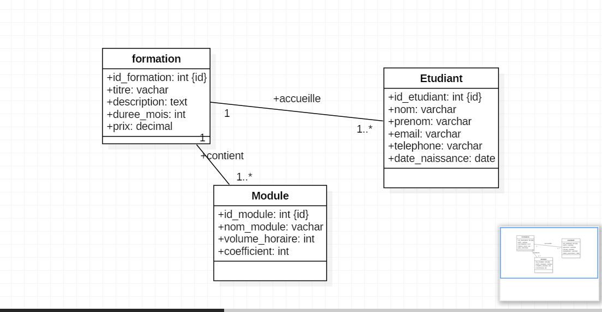
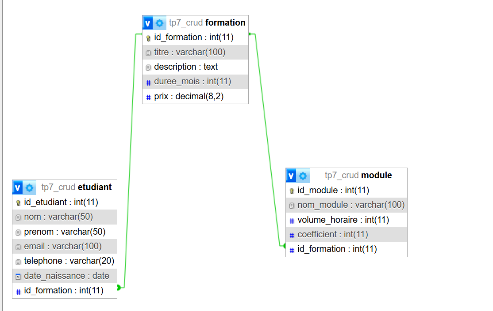
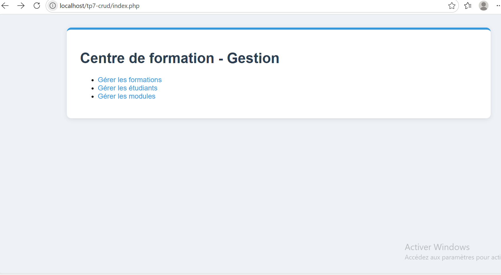
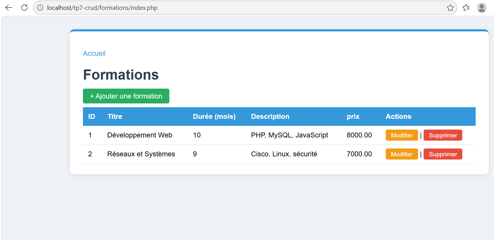
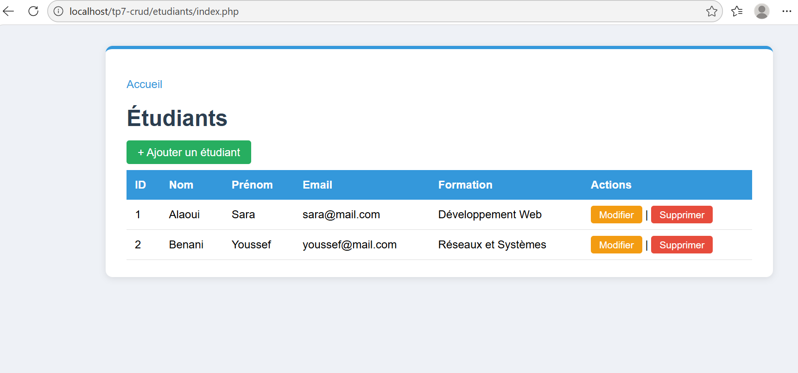
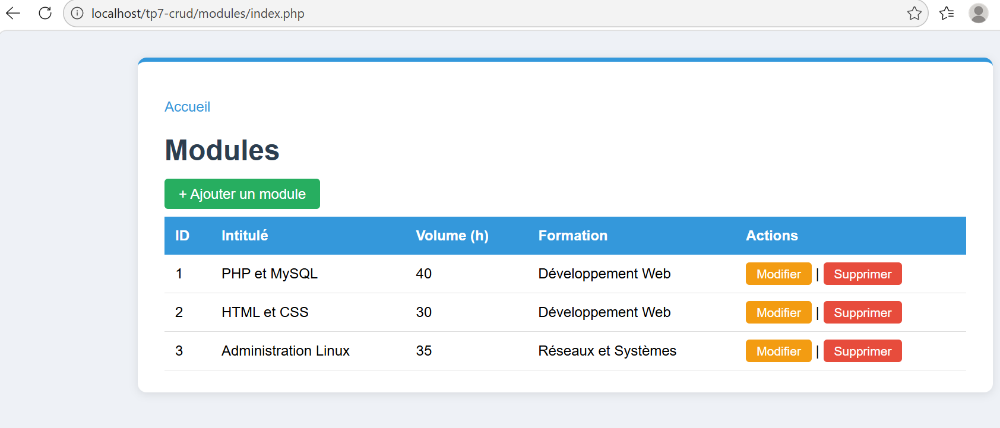
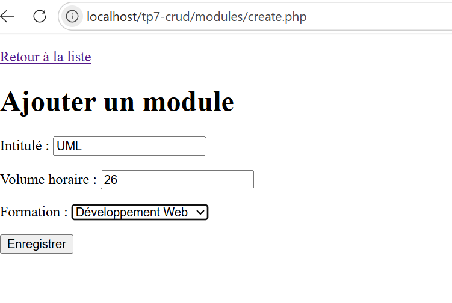
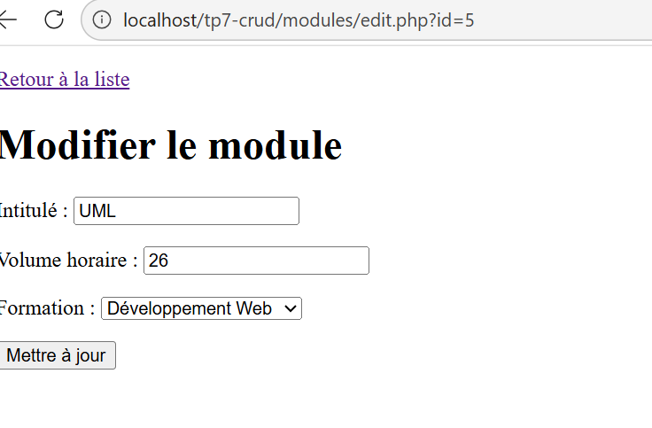
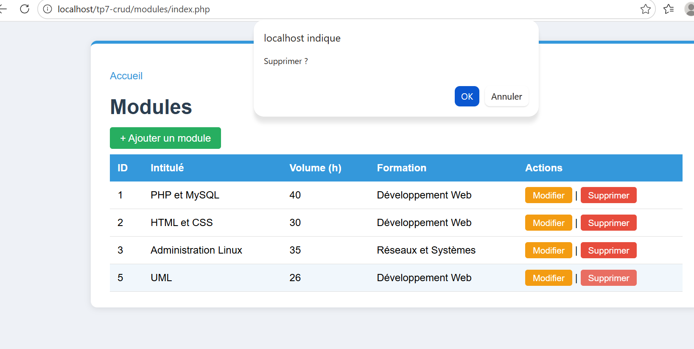
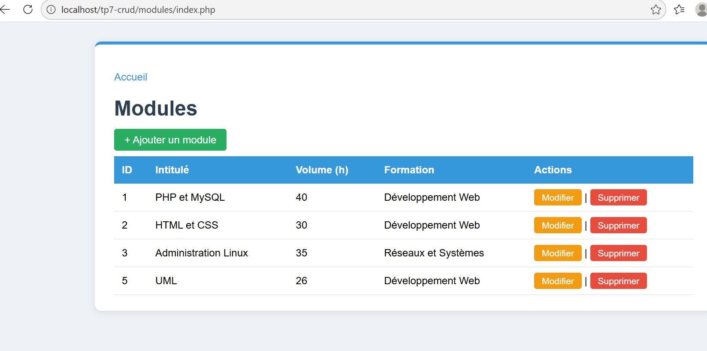

# TP 7 : Gestion d'un centre de formation (CRUD multi-entités)

Petite application web en **PHP**, **PDO** et **MySQL** pour gérer les **formations**, les **étudiants** et les **modules** d'un centre de formation.

---

## Sommaire

1. Le besoin (règles métier)
2. Le diagramme
3. La base MySQL (3 tables reliées)
4. Installer et lancer le projet
5. La connexion PDO centralisée
6. La page d'accueil
7. Le CRUD complet (3 entités)
8. Formulaires qui utilisent les relations
9. Affichage lisible des données liées
10. Tests effectués

---

## 1. Le besoin (règles métier)

Un centre de formation veut une petite application pour organiser ses activités :

- le centre propose **plusieurs formations** ;
- chaque **étudiant** est rattaché à **une seule formation** ;
- une formation peut accueillir **plusieurs étudiants** ;
- chaque formation contient **plusieurs modules** ;
- chaque **module** appartient à **une seule formation**.

---

## 2. Le diagramme

### Les 3 entités

| Entité | Clé primaire (PK) | Clé étrangère (FK) | Autres attributs |
|---|---|---|---|
| **formation** | `id_formation` | aucune | `titre`, `description`, `duree_mois`, `prix` |
| **etudiant** | `id_etudiant` | `id_formation` | `nom`, `prenom`, `email`, `telephone`, `date_naissance` |
| **module** | `id_module` | `id_formation` | `nom_module`, `volume_horaire`, `coefficient` |

### Les 2 relations

- **formation 1 ── N etudiant** : une formation a plusieurs étudiants, un étudiant a une seule formation.
- **formation 1 ── N module** : une formation a plusieurs modules, un module a une seule formation.


### Capture du diagramme (dans logiciel STARTUML)



Les traits verts montrent les clés étrangères : `etudiant.id_formation` et `module.id_formation` pointent vers `formation.id_formation`.


---

## 3. La base MySQL

La base s'appelle **`tp7_crud`**. Le script complet est dans le fichier **`database.sql`** (tables + données de test).


### Explications simples

| Élément | Rôle |
|---|---|
| `AUTO_INCREMENT PRIMARY KEY` | MySQL donne automatiquement un numéro unique (1, 2, 3...) à chaque ligne |
| `INT`, `VARCHAR`, `TEXT`, `DECIMAL`, `DATE` | Types adaptés : nombre entier, texte court, texte long, nombre avec virgule (prix), date |
| `NOT NULL` | La valeur est obligatoire |
| `FOREIGN KEY ... REFERENCES formation(id_formation)` | Relie l'étudiant (ou le module) à une formation qui **existe vraiment** |
| `ON DELETE CASCADE` | Si on supprime une formation, ses étudiants et ses modules sont supprimés automatiquement |
| `ENGINE=InnoDB` | Moteur MySQL qui gère les clés étrangères |


### Vérifier la structure dans phpMyAdmin

Capture du **Concepteur** de phpMyAdmin : les 3 tables sont bien reliées.



---

## 4. Installer et lancer le projet

1. Installer et ouvrir **XAMPP**, puis démarrer **Apache** et **MySQL**.
2. Copier le dossier `tp7-crud` dans `C:\xampp\htdocs\`.
3. Ouvrir `http://localhost/phpmyadmin`.
4. Créer la base **`tp7_crud`** (interclassement `utf8mb4_general_ci`).
5. Cliquer sur la base, puis sur l'onglet **SQL**, coller le contenu de `database.sql` et cliquer sur **Exécuter**.
6. Ouvrir l'application : **`http://localhost/tp7-crud/`**


---

## 5. La connexion PDO centralisée

Fichier : `database/connexion.php`

| Partie | Rôle |
|---|---|
| `new PDO(...)` | Ouvre la connexion à MySQL. Le résultat est dans la variable `$pdo` |
| `host=localhost;dbname=tp7_crud` | Le serveur et le nom de la base |
| `ERRMODE_EXCEPTION` | PDO signale clairement les erreurs SQL |
| `FETCH_ASSOC` | Les résultats sont des tableaux : `$ligne['nom']` |
| `try / catch` | Affiche un message propre si la connexion échoue |
| `function h()` | Raccourci de `htmlspecialchars` : sécurise l'affichage |

**Réutilisation** : chaque page commence par

```php
<?php require_once '../database/connexion.php';
```

(sans `../` pour `index.php` à la racine). La connexion est donc écrite **une seule fois** et utilisée partout.

---

## 6. La page d'accueil

Fichier : `index.php`

Elle contient trois liens vers les trois espaces de gestion :

- Gérer les formations → `formations/index.php`
- Gérer les étudiants → `etudiants/index.php`
- Gérer les modules → `modules/index.php`

Dans chaque liste, un lien **Accueil** permet de revenir ici, et dans chaque formulaire un lien **Retour à la liste** permet de revenir à la liste.

### Capture



---

## 7. Le CRUD complet

CRUD = **C**reate (ajouter), **R**ead (lire), **U**pdate (modifier), **D**elete (supprimer). Il est réalisé pour chacune des 3 entités.

| Opération | Fichier | Ce qu'il fait |
|---|---|---|
| **READ** | `index.php` | Fait un `SELECT`, récupère les lignes avec `fetchAll(PDO::FETCH_ASSOC)` et les affiche dans un tableau HTML avec les liens Modifier et Supprimer |
| **CREATE** | `create.php` | Affiche un formulaire (méthode POST). À l'envoi : `prepare()` d'un `INSERT`, puis `execute()`, puis redirection vers la liste |
| **UPDATE** | `edit.php` | Lit l'`id` dans l'URL, charge la ligne, préremplit le formulaire. À l'envoi : `UPDATE ... WHERE id = ?`, puis redirection vers la liste |
| **DELETE** | `delete.php` | Lit l'`id` dans l'URL, exécute `DELETE ... WHERE id = ?`, puis redirection vers la liste |


### Captures du CRUD

**READ** : les trois listes.







**CREATE** : formulaire d'ajout d'un module (la formation est choisie dans une liste).



**UPDATE** : formulaire de modification prérempli.



**DELETE** : confirmation avant la suppression.




---

## 8. Formulaires qui utilisent les relations

Dans `etudiants/create.php`, `etudiants/edit.php`, `modules/create.php` et `modules/edit.php`, l'utilisateur ne tape pas un numéro de formation : il **choisit un titre dans une liste** (`<select>`) remplie depuis MySQL.

**Étape 1 : récupérer les formations**

```php
$formations = $pdo->query("SELECT id_formation, titre FROM formation ORDER BY titre")
                  ->fetchAll(PDO::FETCH_ASSOC);
```

**Étape 2 : construire la liste**

```php
<select name="id_formation" required>
  <option value="">-- Choisir --</option>
  <?php foreach ($formations as $f): ?>
    <option value="<?= $f['id_formation'] ?>"><?= h($f['titre']) ?></option>
  <?php endforeach; ?>
</select>
```

- Ce que l'utilisateur **voit** : le titre (« Développement Web »).
- Ce qui est **envoyé et enregistré** : l'id (`value`, par exemple `1`).

**Dans `edit.php`**, la formation actuelle est présélectionnée avec l'attribut `selected` :

```php
<option value="<?= $f['id_formation'] ?>"
  <?= $f['id_formation'] == $e['id_formation'] ? 'selected' : '' ?>>
```

Comme la liste lit la table `formation`, toute nouvelle formation ajoutée apparaît automatiquement dans les formulaires.

---

## 9. Affichage lisible des données liées

Dans la table `etudiant`, la colonne `id_formation` ne contient qu'un numéro. Pour afficher le **nom** de la formation, les listes utilisent une **jointure** (`JOIN`).


---

## 10. Tests effectués

À cocher après avoir testé l'application dans le navigateur (`http://localhost/tp7-crud/`).

### Preuves des tests

**Test 1 : les 3 listes s'affichent** (voir les captures des listes dans la section 7).

**Test 2 : ajout d'un module.** Le module « UML » (26 h, Développement Web) est ajouté avec le formulaire, puis on est redirigé vers la liste où la nouvelle ligne apparaît.



**Test 3 : modification.** Le formulaire de modification (`edit.php?id=5`) est prérempli avec les valeurs du module et la bonne formation est sélectionnée (voir la capture dans la section 7).

**Test 4 : suppression.** Un message de confirmation s'affiche avant de supprimer (voir la capture dans la section 7).
